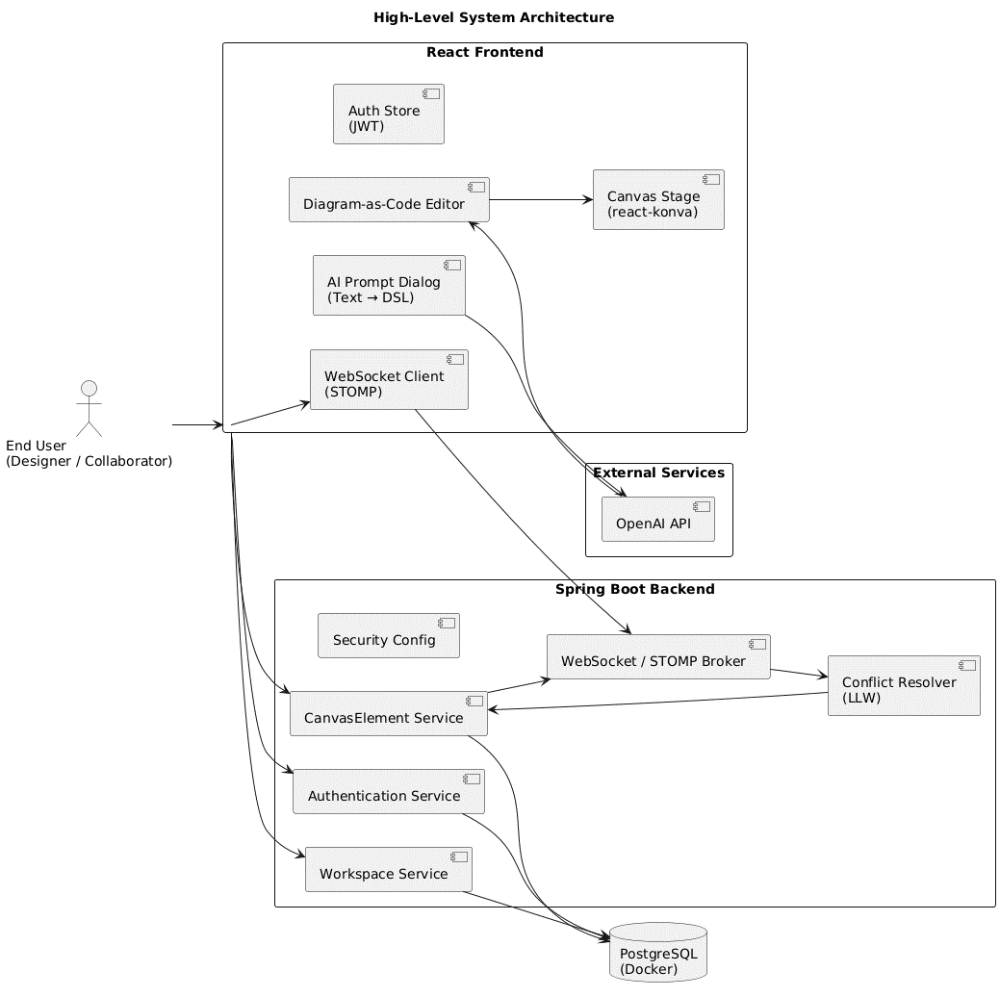

# Cloud Architecture Diagram Editor

A browser-based tool for creating cloud architecture diagrams in three
ways: draw them on a canvas, describe them in a small diagram language,
or start from a text prompt. It also includes shared workspaces so
multiple people can work on the same diagram.

The idea is simple: getting a first version of an architecture diagram
should not require placing every box by hand, and making changes later
should not mean choosing between a visual editor and code.

> **Project status:** This repository contains an early working
> implementation. It is useful for exploring the design and core
> features, but it should not be treated as a production-ready
> architecture or collaboration platform.

## Screenshots

Add screenshots to `docs/images/` and update the paths below.

  -------------------------------------------------------------------------
  Workspace and canvas                Diagram-as-code editor
  ----------------------------------- -------------------------------------
       editor](docs/images/dsl-editor.png)

  -------------------------------------------------------------------------

  ------------------------------------------------------------------------------------
  Generate a diagram from a prompt         Live collaboration
  ---------------------------------------- -------------------------------------------
     workspace](docs/images/collaboration.png)

  ------------------------------------------------------------------------------------

```{=html}
<!-- Optional: add a short GIF showing a diagram being generated and then edited. -->
```
```{=html}
<!--  -->
```
## What it can do

-   **Draw diagrams visually.** Add and move elements on an open canvas,
    connect them, and use common canvas actions such as zooming and
    panning.
-   **Use a diagram language.** Write a small amount of readable text to
    define nodes, groups, and connections. The editor parses it and
    renders the result on the canvas.
-   **Generate a first draft with AI.** Describe an architecture in
    plain English and ask the model to return the diagram language. The
    parser then turns that text into editable diagram elements.
-   **Work in a shared workspace.** Changes are sent through a WebSocket
    connection and broadcast to other connected users.
-   **Keep workspace data.** User, workspace, collaborator, and
    diagram-element data are stored in PostgreSQL.

The included cloud-service icon set focuses on AWS. The diagram language
and icon list are limited to what the implementation recognises.

## How it is put together



The application uses a client--server structure. The browser handles the
editor and diagram-language parsing. The Java backend handles workspace
data, persistence, and collaboration events. PostgreSQL stores the saved
data, and the AI feature calls OpenAI to turn a prompt into
diagram-language text.

### Main parts

  -----------------------------------------------------------------------
  Part                                Responsibility
  ----------------------------------- -----------------------------------
  React frontend                      Workspace screens, canvas, code
                                      editor, prompt input, and user
                                      interactions

  TypeScript diagram parser           Reads the diagram language and
                                      creates a structured representation
                                      of nodes, groups, and connections

  Dagre                               Helps arrange diagram elements
                                      produced from code

  Spring Boot backend                 REST endpoints, workspace and user
                                      operations, and collaboration event
                                      handling

  Spring WebSocket with STOMP and     Sends editing events to the backend
  SockJS                              and broadcasts updates to workspace
                                      subscribers

  Spring Data JPA                     Maps backend data to database
                                      records

  PostgreSQL                          Stores users, workspaces,
                                      collaborator roles, and diagram
                                      elements

  Docker Compose                      Runs the database for local
                                      development

  OpenAI API (GPT-3.5 Turbo in the    Generates diagram-language text
  original implementation)            from a natural-language prompt
  -----------------------------------------------------------------------

### Diagram-language flow

1.  A user writes or edits the diagram language.
2.  The frontend parser reads it line by line.
3.  It recognises node definitions, nested groups, and connections.
4.  The parser creates a structured diagram object.
5.  The layout and canvas rendering code use that object to display the
    diagram.

The parser runs in the frontend. This keeps the code editor responsive
and lets the same browser application turn generated or hand-written
diagram text into a canvas view without asking the backend to parse it.

### Text-to-diagram flow

1.  The user enters a description of the desired architecture.
2.  The application sends the prompt to the OpenAI API.
3.  The prompt instructions ask the model to return only the supported
    diagram language and to use known icon names.
4.  The returned text is passed through the same parser used by the code
    editor.
5.  The resulting elements are shown on the canvas and can be edited.

AI output is a starting point, not a guarantee of a correct design.
Check service names, connections, security boundaries, and other
architectural choices before relying on a generated diagram.

### Collaboration flow

1.  A browser sends an editing event through the `/app/...` STOMP
    destination.
2.  The backend handles the event and saves applicable changes.
3.  The backend publishes updates to a workspace-specific `/topic/...`
    destination.
4.  Connected clients receive the event and update their view.

The WebSocket endpoint is configured at `/ws`, with SockJS support. The
implementation uses a simple STOMP broker with `/topic` for
subscriptions and `/app` for application messages.

## Important design decisions

### One diagram, two editing styles

The canvas and code editor are two ways to work with the same kind of
diagram, rather than separate tools. Visual editing is useful for
positioning and quick changes. The text form is useful for defining
structure and making repeatable edits. AI generation uses that same text
form, so the result remains editable instead of being a flat image.

### A small custom language

The diagram language is inspired by the readable style of tools such as
PlantUML, but it is tailored to the needs of this implementation. It
supports labels, icons, nested groups, and connections without requiring
users to learn a general-purpose programming language.

The parser uses a line-by-line scan, regular expressions for node
definitions, and a stack to track nested groups. Nodes receive generated
IDs. Connections are parsed separately from node definitions. This
approach was chosen because the language is deliberately small; a full
compiler would add complexity without much benefit for the current
feature set.

### Continue when a line is invalid

The parser is designed to be forgiving. Lines it cannot understand may
be skipped, and an unrecognised icon can fall back to a plain shape
rather than stopping the whole diagram from rendering. This helps when a
user is editing by hand or when an AI response is only partly valid.

The trade-off is that a diagram can render while still missing something
the user intended. Review the output rather than treating a successful
render as proof that the source is correct.

### Last-write-wins collaboration

The backend uses a simple last-write-wins approach for conflicting
edits: when competing updates affect the same element, the later
accepted update takes precedence. This was chosen because diagram edits
are often larger, discrete actions and the approach is comparatively
straightforward to implement.

It is not a full conflict-free editing system. Two users changing the
same element can overwrite each other's work. A more robust conflict
model, such as a carefully designed CRDT-based approach, would be worth
considering before using this with larger teams or important diagrams.

### Persist important state, not every transient action

Workspace and diagram data is stored in PostgreSQL. Short-lived activity
such as cursor movement can be broadcast to connected clients without
being written to the database. This keeps persistent storage focused on
information needed to restore the workspace.

### Keep AI output inside the editor's own format

The model is instructed to return the diagram language rather than an
image or a long explanation. That lets the application reuse its
existing parser and editing flow. It also means the model must follow
the language and icon names supported by the application; unsupported
output may be skipped or rendered with fallback shapes.

## Diagram language examples

### Nodes

A node has a label and can optionally specify an icon:

``` text
API [icon: AWSApiGateway]
Lambda [icon: AwsLambda]
Database [icon: AWSRDS]
```

### Groups

Curly braces put related elements inside a group. Groups can be nested:

``` text
VPC {
  Subnet {
    Application Server [icon: AWSEC2]
    Database [icon: AWSRDS]
  }
}
```

### Connections

Use `>` for a one-way connection, `<` for the reverse/bidirectional form
supported by the parser, and `-` for a plain line:

``` text
API > Lambda
Lambda > Database
Client < API
Application Server - Cache
```

A connection can also point to more than one target:

``` text
API > Lambda, Cache
```

Icon names must match the names recognised by the application's icon
list. The examples above show the style of the language; check the
actual icon list in the source before using a service name.

## Data model

The persistent model is kept deliberately small. It includes:

-   **Users** --- account information.
-   **Workspaces** --- named diagram workspaces.
-   **Workspace collaborators** --- links a user to a workspace and
    records a role such as `OWNER` or `COLLABORATOR`.
-   **Canvas elements** --- saved diagram elements associated with a
    workspace, including their type and data.

The backend uses Spring Data JPA for persistence. Real-time events such
as cursor movement do not need to be saved as diagram records.


## Run locally

These instructions reflect the setup described for the project. Exact
commands may need small changes depending on the scripts and
configuration in the checked-out source.

### Requirements

Install the following first:

-   Docker and Docker Compose
-   Node.js and npm
-   Java Development Kit (JDK)
-   Maven
-   A modern browser such as Chrome

### 1. Start PostgreSQL

Open a terminal in the backend directory that contains
`docker-compose.yml`, then run:

``` bash
docker-compose up -d
docker ps
```

Check that the database container is running.

### 2. Configure the backend

Open the backend project directory. Check the application's
configuration for the database URL, username, password, and server port.
Set local values to match your Docker Compose configuration.

Then build and run the Spring Boot application:

``` bash
mvn clean install
mvn spring-boot:run
```

You can also run the backend from your Java IDE.

### 3. Configure the frontend

Open the frontend directory. The original setup instructions refer to a
directory named `frontend-updated`; use the actual frontend directory
name in this repository if it differs.

Install the packages:

``` bash
npm install
```

Configure the frontend's backend URL and AI settings using the
configuration approach already present in the codebase. Do not commit
API keys or other secrets.

Start the frontend using the script defined in `package.json`. The
original project instructions use:

``` bash
npm start
```

If this script is not defined in the current checkout, inspect
`package.json` and use the available development script.

### 4. Open the application

Open the local address printed by the frontend development server.
Register or sign in, create a workspace, and open it to start drawing.

> **Setup note:** The report describes the main local setup, but it does
> not provide enough detail to guarantee every environment variable,
> port, or credential for every checkout. Confirm those values in the
> backend configuration, `docker-compose.yml`, and frontend
> configuration before running the app.

## Configuration and API keys

The AI feature requires an OpenAI API key and access to a model
supported by the implementation. Model names and API behaviour can
change, so check the API call in the source before running it.

## Known limitations

-   **AI output needs review.** The model can choose the wrong service,
    invent a name, or create a connection that does not make
    architectural sense.
-   **The language has a limited vocabulary.** It supports the syntax
    and icon names implemented in the parser, with an AWS-focused icon
    set.
-   **Invalid lines can be skipped.** This keeps the rest of a diagram
    usable, but can hide missing parts unless the source is checked.
-   **Concurrent edits can overwrite one another.** Last-write-wins is
    simple, but it does not preserve every user's intent when the same
    element is edited at the same time.
-   **Automatic layout is not always ideal.** Complex diagrams may need
    manual positioning and refinement.
-   **The implementation is an early version.** Authentication,
    workspace permissions, error handling, deployment settings, and
    security controls should be reviewed carefully before exposing a
    public instance to real users.

## Ideas for further work

These are possible next steps, not features already provided:

-   Improve parser feedback so skipped lines and unknown icons are
    visible to the user.
-   Expand the supported icons and add Azure and Google Cloud services.
-   Improve automatic layout for nested and larger diagrams.
-   Replace the basic conflict rule with a more robust approach and add
    clearer presence indicators.
-   Move AI calls to the backend and add rate limits, validation, and
    better failure messages.
-   Add tests for parsing, layout, collaboration events, and
    AI-generated output.
-   Explore exporting diagram structure into starter infrastructure
    code, such as Terraform or AWS CDK.

## Testing and evaluation notes

The original implementation was checked with manual diagramming tasks
and simulated collaboration sessions. The reported results were:

-   Initial three-tier architecture draft: **3.2 minutes** with the
    tool, compared with **13.1 minutes** in draw.io and **15.7 minutes**
    in PlantUML.
-   Diagram changes: the reported average for the tool was **2.1
    minutes**.
-   AI-generated syntax: **22 of 25 prompts** were reported as
    parseable.
-   The evaluation also found cases where the diagram could be parsed
    but the architecture itself was wrong.

These are results from a small, controlled evaluation of this
implementation, not a promise of performance for every diagram or user.
The report contains inconsistencies in some of its AI accuracy
percentages, so the prompt counts above are the safer figures to quote.

## Contributing

Issues, bug reports, and focused improvements are welcome. When
reporting a problem, include:

-   What you were trying to do
-   The diagram-language snippet, if relevant
-   What you expected and what happened
-   Browser and runtime details
-   Steps to reproduce the issue

Please remove API keys, passwords, and private architecture details
before opening an issue.

## Acknowledgements

This project builds on open-source tools and libraries including React,
Spring Boot, PostgreSQL, STOMP, SockJS, and Dagre, as well as the OpenAI
API. Please check the dependency files for the exact packages and
versions used in this checkout.
